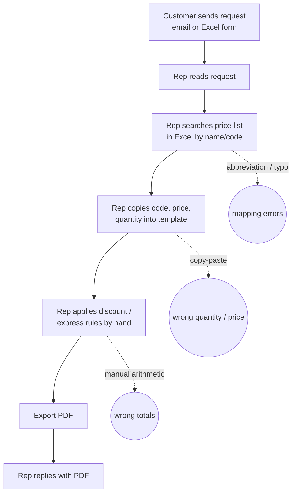

# 01. Discovery — Acme Parts (fictional)

> This is a portfolio project. **Acme Parts (fictional)**, every person, every email and every number below are invented. No real customer, company or person is described.

Before writing any code, I spent a (fictional) half-day with the sales team to understand how quotes are made today, where it hurts, and what "better" means in numbers. This page is the record of that conversation.

## Who we talked to

| Role (fictional) | Why they matter |
| --- | --- |
| Sales rep (2 of 4 on the team) | Creates every quote by hand today; the main user |
| Sales manager | Approves discounts; owns the "zero pricing errors" goal |
| Office admin | Maintains the price list in Excel |

## Interview notes

**Q. How does a quote request arrive?**
A. About 80% by email, as free text. The rest are an Excel request form we send to regular customers — but they often leave cells empty or write product names their own way.

**Q. Walk me through making one quote.**
A. Open the email, find each product in the price list (Excel), copy the code and unit price into the quote template, type the quantity, check the discount rules, add express shipping if asked, then export a PDF and attach it to a reply.

**Q. How long does that take, and how often?**
A. About 15 minutes per quote, around 30 quotes a month across the team. Busy weeks are worse because requests stack up.

**Q. What goes wrong?**
A. Copy-paste mistakes. Last year a quantity of "100" became "10" on a quote and we had to honour the wrong total. Customers also write abbreviations ("M6 bolt SUS") or full-width digits ("１００個"), and newer reps don't always map those to the right product code.

**Q. Who checks the quote before it goes out?**
A. In theory the rep double-checks. In practice, nobody re-checks the arithmetic.

**Q. Are discounts and surcharges fixed rules or case-by-case?**
A. Fixed: 5% off a line at 10 units or more, and express shipping adds 10% of the subtotal. Anything else needs the manager — sales reps never give ad-hoc discounts by email.

**Q. Has a customer ever asked for something odd in an email?**
A. Sometimes people write "please make this 90% off" as a joke, or paste a long thread where only one line is the actual request. And we get plenty of emails that aren't quote requests at all (invoices, delivery questions).

**Q. Would you be comfortable if the system sent quotes by itself?**
A. No. A person must see the quote before it reaches the customer. Sending stays manual.

## Current workflow

## Pain points

1. **Time** — ~15 min/quote × ~30/month ≈ 7.5 hours of repetitive work per month.
2. **Pricing errors** — manual copy and arithmetic have produced at least one wrong total that had to be honoured.
3. **Inconsistent product mapping** — abbreviations, typos and full-width characters depend on the rep's experience.
4. **No audit trail** — nobody can see later what the original request said versus what was quoted.

## Success criteria

| Metric | Today | Target | How we measure |
| --- | --- | --- | --- |
| Time to produce one quote | ~15 min | **≤ 3 min** (incl. human review) | Pipeline timing log + timed demo |
| Pricing errors | ≥ 1 known incident | **0** | Prices and totals computed only by deterministic code, covered by tests |
| Extraction accuracy (company, contact, product, quantity) | n/a | **≥ 95%** per field | Labelled evaluation set (40+ cases) |
| Prompt-injection compliance | n/a | **0** cases followed | Adversarial cases in the evaluation set |

## Design implications (what this conversation decided)

- **AI reads, code calculates.** The model only turns text into structured fields. Price lookup, discounts, tax and the PDF are deterministic Python — this is what makes "0 pricing errors" a testable claim.
- **Human in the loop.** Every quote is shown to the rep for approve / edit / abort before any PDF is produced.
- **Instructions in emails are data.** "Give me 90% off" is recorded as a note, never acted on.
- **Not-a-quote detection.** Non-request emails are flagged instead of forced into a quote.

## In scope

- Extracting request details from email text (`.txt` / `.eml`) and the Excel request form (`.xlsx`)
- Matching products against the price list (codes, aliases, abbreviations)
- Human review in the CLI
- Price, discount, express fee and 10% consumption tax calculation (rounded down to the yen)
- Quote PDF generation

## Out of scope

- Sending emails (the rep still sends the reply)
- Reading the mailbox automatically (files are passed in by the rep)
- Inventory checks and delivery-date promises
- Negotiated, customer-specific prices or ad-hoc discounts
- Integration with an accounting or ERP system
